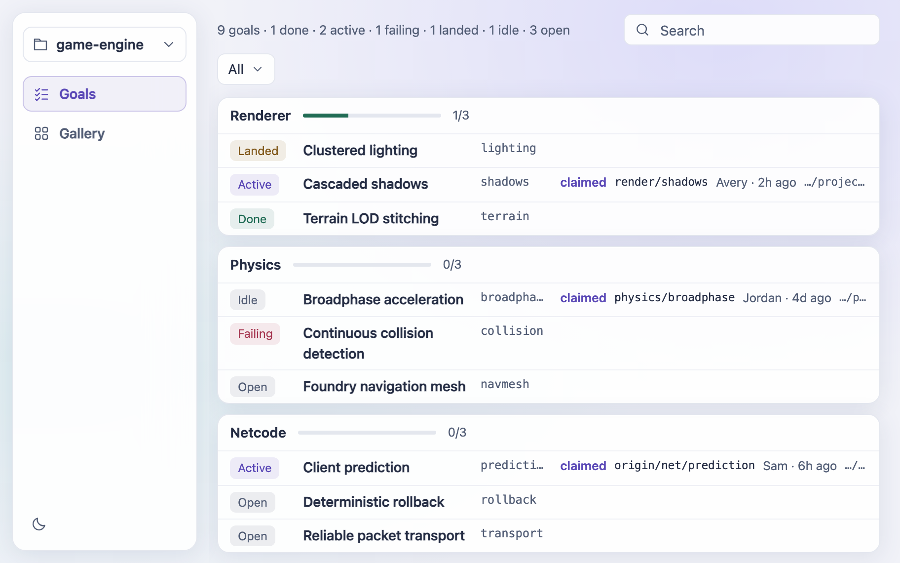
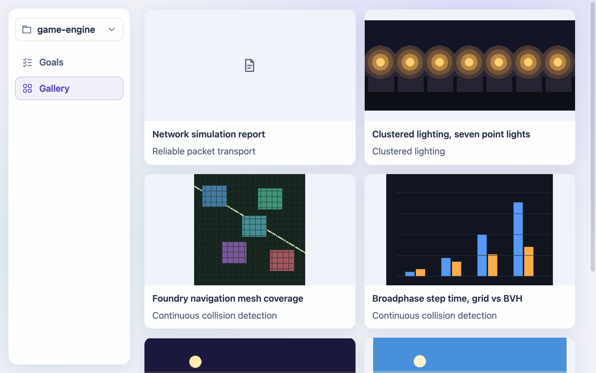
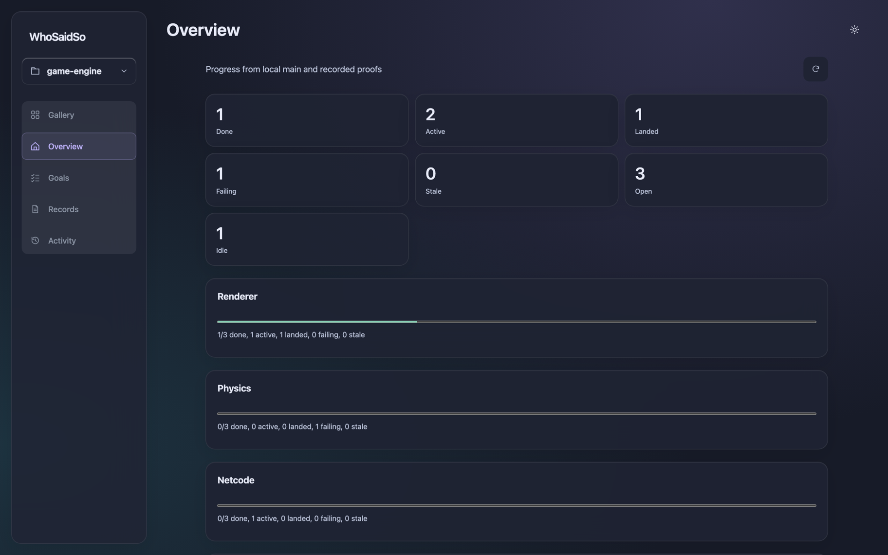

# WhoSaidSo

A ledger in your git repo for goals worked on by many agents. Goals have evidence: a recorded run or an attached file. Agents claim work and keep its proof; progress is derived from Git.





## Install

Tell your coding agent:

```text
Install WhoSaidSo from https://github.com/alex2481kobe/whosaidso and set it up in this project.
```

Or install it yourself (needs Rust, Cargo and Git):

```text
cargo install --git https://github.com/alex2481kobe/whosaidso --tag v0.3.1 --locked
```

## Quick start

In a Git repository with an initial commit, create a goal:

```sh
mkdir -p .whosaidso/goals
printf '%s\n' '{"title":"First goal","done_when":"The feature file exists","parent":null,"order":1,"after":[],"check":["sh","-c","test -f feature.txt"]}' > .whosaidso/goals/first-goal.json
whosaidso check
whosaidso install-hooks
git add .whosaidso
git commit -m 'Add records'
```

Claim the goal, commit the work, and keep its evidence:

```sh
whosaidso start first-goal
printf '%s\n' 'Example feature' > feature.txt
git add feature.txt
git commit -m 'Add feature'
whosaidso goals
whosaidso prove first-goal --reason "demonstration on main"
git add .whosaidso/proofs
git commit -m 'Record evidence'
```

Run `install-hooks` once per clone. Goal state is derived from Git; evidence on the default branch completes a goal. A check is optional: a file attachment can also provide evidence. Keep checks short and focused on real behavior.

## Code search

```sh
whosaidso find first goal
whosaidso grep search text --in src/
whosaidso code defs physics::cross
whosaidso code refs cross
whosaidso code deps src/main.cpp
whosaidso code includers src/types.h
```

`find` searches records, files and history; `grep` searches file text; `code defs`/`refs` find where a name is defined and used; `code deps`/`includers` show what a file includes and what includes it. C, C++, Rust and Python work out of the box; `whosaidso code import-scip <file>` adds exact answers from a SCIP index.

## Viewer

`whosaidso ui` serves a read-only viewer on your machine, with Goals and Gallery. `--open` opens your browser.

See [USAGE.md](USAGE.md) for every command and record format. Contributing: [CONTRIBUTING.md](CONTRIBUTING.md). Apache-2.0.
