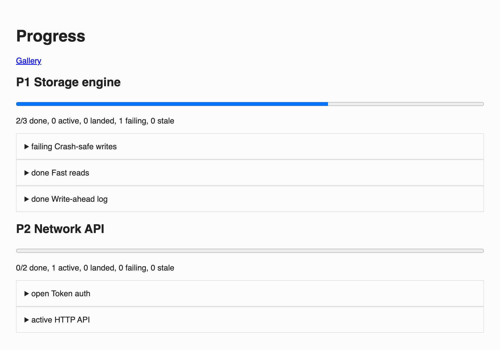

<h1 align="center">WhoSaidSo</h1>

<p align="center">
  <strong>Keep your agents accountable and your claims proven.</strong><br />
  Goals, proofs and evidence live in your repository, and progress is worked out from what actually landed.
</p>

<p align="center">
  <a href="#get-started">Get started</a> ·
  <a href="#what-it-is-built-on">What it is built on</a> ·
  <a href="USAGE.md">Usage and record formats</a>
</p>



WhoSaidSo is for your agents, not for you to operate. They write down the goals they are working toward, prove
them by running the checks you agreed on, and attach evidence: screenshots, videos and documents. A new session
runs `whosaidso goals` and knows where things stand without being told again. You read along whenever you want, in
the terminal or with `whosaidso view`, which writes a plain progress page and a gallery of the evidence.

It is one small Rust program. A project's record is small JSON files in `.whosaidso/`, committed with your code, so
it branches, merges and travels with the work. A goal's state is never stored: it is worked out from Git and the
proofs every time you ask.


## What it is built on

**Proven, not claimed.** A goal is done when its instrument has passed on the code that landed on main. A proof
records the exact commit, the exit code and the output, and stops counting when the instrument changes.

**Instruments that admit their blind spots.** Each instrument says what it answers and what it cannot see, and names
the instrument that covers each gap. Proving a goal runs them all.

**State from Git.** Open, active, landed, done, failing and stale are worked out from local branches, local main and
the proofs. There is no status field to forget to update.

**Evidence that is kept.** Media is detected by its signature, stored by content hash and never deleted: the newest
100 items stay in the gallery, and older ones move into monthly archive bundles you can open with `tar`.

**Bounded by design.** Records, output tails, asks and search answers all have fixed caps, so a long-running project
stays small enough for an agent to read. `prune` keeps it that way, and recoverably: an interrupted prune is undone
and run again by the next one.

**Agent first.** Short, predictable answers made for coding agents doing the work every day, plus search over the
records, the files and the code.

## Get started

Tell your coding agent:

```text
Install WhoSaidSo from https://github.com/alex2481kobe/whosaidso and set it up in this project.
```

Or do it yourself. Building needs Rust, Cargo, Git and a Unix shell:

```text
cargo install --git https://github.com/alex2481kobe/whosaidso --tag v0.3.0 --locked
```

## Quick start

In a Git repository, create the first records (there is no initialization command):

```sh
mkdir -p .whosaidso/phases .whosaidso/goals .whosaidso/instruments
printf '%s\n' '{"title":"First phase","order":1}' > .whosaidso/phases/p1.json
printf '%s\n' '{"run":["cargo","test"],"answers":"Tests pass"}' > .whosaidso/instruments/test.json
printf '%s\n' '{"title":"First goal","done_when":"Tests pass","check":"test","broader":"p1"}' > .whosaidso/goals/first-goal.json
whosaidso check
whosaidso install-hooks
git add .whosaidso
git commit -m 'Add records'
```

Each clone runs `whosaidso install-hooks` once. `whosaidso start first-goal` selects the goal, and later commits
carry its `Goal:` trailer. After committing work:

```sh
whosaidso goals
whosaidso prove first-goal
whosaidso find first goal
whosaidso grep search text --in src/
whosaidso code defs physics::cross
whosaidso code deps src/main.cpp
whosaidso code includers src/types.h
whosaidso view
```

`prove` writes a proof record to commit with your work. `view` prints the path of the gallery; the progress page
sits beside it. Attach evidence with `whosaidso media <goal> <file> <title>`: PNG, JPEG, GIF, WebP, MP4, MOV,
WebM or PDF, up to 64 MiB each.

## Working with a team

Whoever lands work on main runs `whosaidso prune` and commits its deletions with the landing. The sync recipe is:
pull, prune, commit, push. If the push is rejected, pull and prune again. If prune is interrupted, run it again.

## Works with

Any project and any agent that can run a command. Tested on Linux and macOS in CI; Windows is untested. Until 1.0
the record format may still change.

See [usage and record formats](USAGE.md), [contributing](CONTRIBUTING.md), [changelog](CHANGELOG.md),
[security](SECURITY.md) and the [license](LICENSE) (Apache-2.0).
